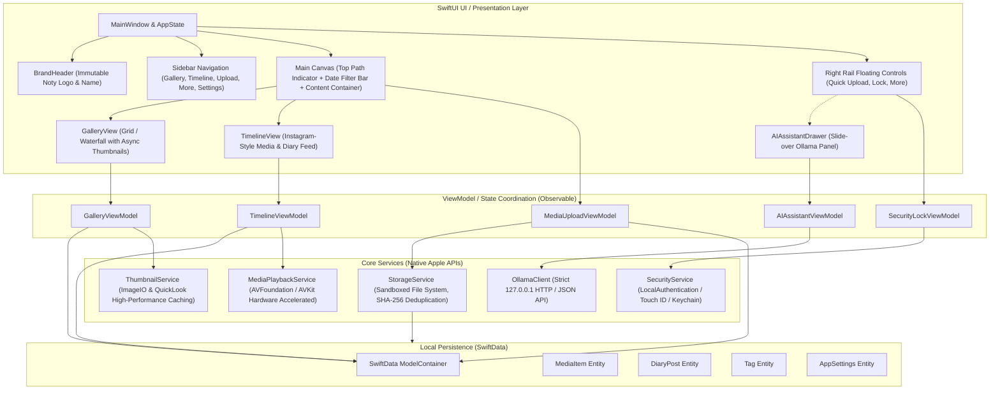
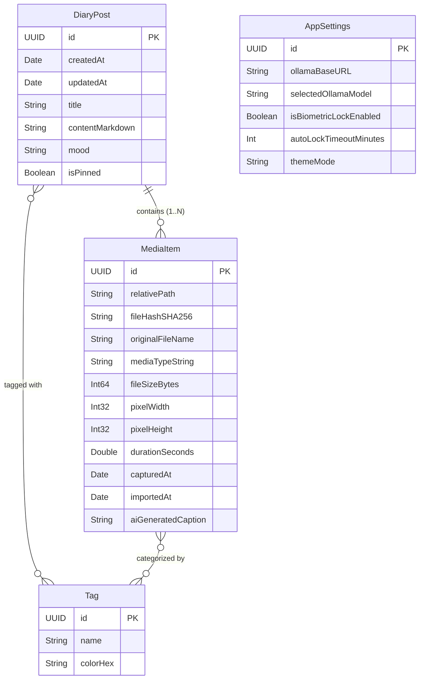

# Noty — 系統架構設計書 (ARCHITECTURE.md)

> **版本**：1.0.0  
> **更新日期**：2026-11-06  
> **架構範式**：SwiftUI Declarative UI + MVVM + Service Layer + SwiftData Repository

---

## 1. 系統整體架構圖

Noty 採用單向資料流與嚴格分層的 macOS 原生架構，所有元件均運行於本機沙盒內。



---

## 2. 專案模組結構（Project Directory Structure）

```
Noty/
├── PROJECT_SPEC.md              # 專案願景、規格與限制
├── ARCHITECTURE.md              # 系統架構、資料模型與元件設計
├── TASKS.md                     # 階段進度與任務追蹤
├── Package.swift                # SPM 專案或 xcodebuild 專案設定檔
├── Sources/
│   └── Noty/
│       ├── App/
│       │   ├── NotyApp.swift               # 應用程式入口點（@main）
│       │   ├── AppState.swift              # 全域狀態（導覽位置、鎖定狀態、側邊欄控制）
│       │   └── WindowConfig.swift          # 原生視窗樣式（Titlebar-less, Unified Sidebar）
│       ├── Models/
│       │   ├── MediaItem.swift             # 媒體檔案實體（照片、影片、規格元資料）
│       │   ├── DiaryPost.swift             # 日記/貼文實體（Markdown 內文、關聯媒體、心情）
│       │   ├── Tag.swift                   # 標籤與分類
│       │   ├── OllamaMessage.swift         # AI 對話與語意搜尋結構
│       │   └── AppSettings.swift           # 本機偏好設定（模型選擇、上鎖逾時、外觀）
│       ├── Services/
│       │   ├── StorageService.swift        # 本機沙盒檔案讀寫、雜湊防重複、匯入管道
│       │   ├── ThumbnailService.swift      # 雙層縮圖快取（記憶體 NSCache + 磁碟檔案）
│       │   ├── OllamaService.swift         # 本機 Ollama API 客戶端（僅允許 127.0.0.1）
│       │   └── SecurityService.swift       # Touch ID / 本機密碼鎖定檢驗
│       ├── ViewModels/
│       │   ├── GalleryViewModel.swift      # 相簿檢索、排序、日曆篩選
│       │   ├── TimelineViewModel.swift     # 圖文貼文時間軸與留言/日記流
│       │   ├── MediaUploadViewModel.swift  # 檔案挑選器、拖曳匯入佇列處理
│       │   ├── AIAssistantViewModel.swift  # AI 抽屜狀態、查詢執行、串流文字解析
│       │   └── SecurityLockViewModel.swift # 保險庫上鎖、解鎖邏輯
│       ├── Views/
│       │   ├── Shell/
│       │   │   ├── MainWindowView.swift    # 頂層視窗容器
│       │   │   ├── BrandHeaderView.swift   # [核心規格] 左上角永久固定 Noty 品牌區
│       │   │   └── SidebarNavigationView.swift # 左側導覽列（Gallery, Timeline, Upload, More）
│       │   ├── Gallery/
│       │   │   ├── GalleryView.swift       # 藝廊主畫面
│       │   │   ├── GalleryHeaderBar.swift  # 手繪稿頂部路徑與日期排序控制列
│       │   │   ├── GalleryEmptyView.swift  # 手繪稿「Nothing here... try upload / open file」
│       │   │   ├── MediaThumbnailCard.swift# 單張媒體卡片（附影片標章與選取態）
│       │   │   └── MediaDetailSheet.swift  # 媒體全螢幕檢視與 Exif 資訊檢驗
│       │   ├── Timeline/
│       │   │   ├── TimelineView.swift      # 類似 Instagram 動態牆
│       │   │   ├── PostCardView.swift      # 圖文卡片、輪播、時間戳與內文
│       │   │   └── PostEditorSheet.swift   # 撰寫日記與發布貼文彈窗
│       │   ├── AI/
│       │   │   ├── AIAssistantDrawer.swift # 右側滑入式 AI 抽屜（對應手繪圖 AI←）
│       │   │   ├── OllamaStatusBadge.swift # Ollama 服務在線狀態燈
│       │   │   └── SmartSearchChatView.swift # 本地智慧對話與搜尋介面
│       │   ├── Controls/
│       │   │   ├── RightFloatingControls.swift # 右上 Quick Upload、右下 Lock 與 More 按鈕
│       │   │   └── LockOverlayView.swift   # 鎖定狀態遮罩（保護私人內容）
│       │   └── Common/
│       │       ├── NotyLogoShape.swift     # 依據手繪稿繪製的 Noty 向量圖標
│       │       └── VideoPlayerView.swift   # AVKit 原生無邊框流暢播放組件
│       └── Resources/
│           ├── Assets.xcassets/            # AppIcon 與品牌原色資源
│           └── Localizable.xcstrings       # 多語系字串支援
└── Tests/
    └── NotyTests/                          # 單元測試與本機儲存沙盒驗證
```

---

## 3. 資料庫設計與 SwiftData 模型架構

所有資料保存在使用者本機之 `~/Library/Application Support/Noty/Noty.store`（由 SwiftData 自動管理）。

### 3.1 核心實體關聯圖



---

## 4. 本機檔案系統與沙盒目錄結構

Noty 不會覆蓋或修改使用者的原始照片，所有匯入檔案均由 `StorageService` 進行非破壞性收納：

```
~/Library/Application Support/Noty/
├── Database/
│   └── default.store                   # SwiftData 本機 SQLite 資料庫
├── Media/
│   ├── Originals/
│   │   ├── 2026/
│   │   │   ├── 11/
│   │   │   │   ├── a8f12c..._IMG_001.heic  # 以 SHA-256 前綴命名的原始檔案
│   │   │   │   └── 39b710..._VID_002.mov
│   └── Thumbnails/
│       ├── Small/                      # 256x256 快速網格滾動縮圖
│       └── Large/                      # 1024x1024 高解析檢視預覽圖
└── Cache/
    └── ollama_embeddings.cache         # 本地 AI 語意特徵快取
```

---

## 5. 手繪原型映射與視覺佈局實作規範

1. **左上角品牌區（`BrandHeaderView`）**：
   - 繪製專屬的 `NotyLogoShape`：具備白底圓角方形、外框細線、中心粗體手寫感「N」、兩側記事橫線，以及象徵對話標記的左下折角。
   - 緊鄰醒目的「Noty」文字，固定顯示於 Window Titlebar 整合區域，點擊可重設導航至預設狀態。
2. **頂部路徑與日期控制列（`GalleryHeaderBar`）**：
   - 完全呼應手繪圖的 `You are now at gallery 🖼️` 導引語句，採用現代化精緻字體，當切換到貼文時無縫變換為 `You are now at timeline 📰`。
   - 日期標題：自動根據本地時間格式化（例：`2026/11/6 (五)`）。
   - 升降排序（`↑` `↓`）與篩選按鈕：以原生 SF Symbols `arrow.up`、`arrow.down`、`line.3.horizontal.decrease.circle` 實作。
3. **中央藝廊容器與空狀態（`GalleryEmptyView`）**：
   - 若相簿尚無媒體，重現手繪圖中可愛且直觀的空狀態：
     - 文字：`Nothing here... :(`
     - 動作按鈕 1：`try [↑ upload]` 觸發檔案挑選器或貼文編輯器。
     - 動作按鈕 2：`[open file...]` 直接開啟原生 `NSOpenPanel` 快速匯入本機媒體。
4. **右上角 `Quick upload`**：
   - 位於內容畫布右上角的浮動按鈕，隨時可用於快速拋入照片或短片。
5. **右側 `AI ←` 側拉抽屜**：
   - 點擊後從視窗右緣平滑滑出（Spring Animation），顯示本地 Ollama 連線狀況、模型切換、照片智慧搜尋框與問答聊天串。
6. **右下角 `Lock 🔒` 與 `More •••`**：
   - `Lock` 按鈕：點擊立刻啟用隱私遮罩，需透過 Touch ID 或本機密碼解鎖。
   - `More` 按鈕：快速叫出導出資料、清空快取、儲存空間分析等輔助功能。

---

## 6. 本機 Ollama AI 通訊協定規範

- **安全邊界**：
  - 嚴格限定端點：僅允許 `URL(string: "http://127.0.0.1:11434")`。
  - 封鎖任何對外公網請求。
- **協定 API 映射**：
  - 健康檢查與模型列表：`GET /api/tags`
  - 語意特徵向量產生：`POST /api/embeddings`
  - 自然語言搜尋與對話串流：`POST /api/chat`（支援 Server-Sent Events / JSON chunk 串流即時打字效果）
- **例外降級策略**：
  - 當本機未安裝或未啟動 Ollama 時，介面友善顯示狀態提示與引導說明，核心媒體庫與日記功能完全不受影響，確保離線可用。

---

## 7. Apple Liquid Glass 設計系統與互動架構

- **視覺語彙**：全面採用 Apple Liquid Glass（圓弧膠囊、多層次動態透明感、光感外框、精緻微陰影）。
- **互動升級**：
  - 核心操作鈕統一為 `.notyPrimary`、`.notySecondary`、`.notyDestructive`、`.liquidCapsule`。
  - 橫向選單（圖庫與日記）採用專屬 `NSClipView` 滾動捕捉器（`.horizontalWheelScroll()`），原生支援滑鼠滾輪橫向平滑滾動，徹底移除生硬的箭頭按鈕。
  - 心情微泡與文字標籤配置 `.fixedSize()`，徹底解決 Apple Color Emoji 基線截斷問題。
- **主題架構**：`AppearanceManager` 全域接管深色、淺色與跟隨系統外觀，支援即時響應與視窗重繪。

---

## 8. 發行與打包架構 (Release & DMG Distribution)

- **原生架構**：鎖定 Apple Silicon `arm64`（排除 x86_64肥二進制）。
- **沙盒與安全性**：啟用 macOS App Sandbox，配置照片/影片使用者授權讀寫權限。
- **打包流水線**：
  - `xcodebuild -configuration Release` 編譯原生 Bundle。
  - 驗證二進制架構與代碼簽署（Ad-Hoc / Developer ID + Hardened Runtime）。
  - 組裝 Staging 目錄（包含 `Noty.app`、`/Applications` 符號連結與 `INSTALL_INSTRUCTIONS.txt`）。
  - 原生 `hdiutil` 壓縮生成 `Noty-arm64.dmg`（UDZO 格式），支援直接掛載拖曳安裝。
