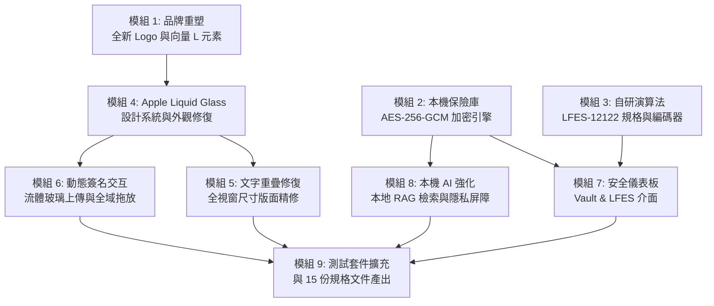

# Noty — Phase 9.75 開發計畫與實施藍圖 (PHASE_9_75_PLAN.md)

> **階段版本**：Phase 9.75 (Ultimate Refinement, Security, Liquid Glass & AI Implementation)  
> **目標平臺**：macOS 14.0+ (Apple Silicon ARM64, 測試機型 Mac mini M4 24GB)  
> **開發原則**：100% 原生 Swift 6 / SwiftUI / SwiftData / CryptoKit / AVKit / 本機 Ollama。零外部第三方依賴，零雲端 API，非破壞性儲存。

---

## 1. 階段目標與核心模組劃分

Phase 9.75 為 Noty 在正式發布（Phase 10 Release & DMG）前最關鍵的大型升級階段，涵蓋安全密碼學、自研演算法、全新品牌識別、全域 Apple Liquid Glass 視覺設計、文字重疊徹底修復、本機 AI 深度整合與簽名級動態上傳交互。

---

## 2. 模組執行規劃

### 模組 1：品牌識別重塑 — 全新 Noty Logo（保留左下角大寫 "L"）
- **手稿深入分析**：忠實依據使用者最新提供之手繪設計稿（`media_1794052396103_a3951c65.jpg`）。
  - 外框：頂部平滑圓角便簽輪廓。
  - 頂部：厚實橫線飾條。
  - 中央：醒目大寫英文字母 `N`，左右兩側各配有上下雙水平短劃線（`- N -` 裝飾結構）。
  - 底部：水平橫線飾條。
  - **左下角核心特徵**：左下角明確保留使用者特別指示之英文字母大寫 **`L`**，絕不修飾成水滴、筆尖或斷水破線，幾何獨立清晰。
- **程式化重製**：
  - 實作向量 `NotyLogoShape` 與獨立組件 `NotyLogoView.swift`。
  - 更新 `BrandHeaderView.swift`、`AboutNotyView.swift`。
  - 升級 `scripts/generate_app_icon.swift`，產生 16×16 至 1024×1024 全套 AppIcon 資源並輸出高解析度預覽。

### 模組 2：真實 AES-256-GCM 本機保險庫加密引擎
- **演算法核心**：採用 Apple 原生 `CryptoKit.AES.GCM` 認證加密。
- **Master Key 推導**：
  - 採用 `CommonCrypto` 之 `CCKeyDerivationPBKDF`（PBKDF2-HMAC-SHA256），迭代次數設定為 **600,000 次**。
  - 每次推導均採用 32 位元組獨立密碼學安全隨機 Salt（`SecRandomCopyBytes`）。
  - 金鑰材料妥善保護於 macOS Keychain，支援 Touch ID 與本機獨立密碼解鎖。
- **4 MiB 分塊串流加密**：
  - 針對大型照片與 4K 影片，實作串流式分塊（Chunk Size: 4 MiB）。
  - 每個 Chunk 具備獨立單調遞增 Nonce 與 16 位元組 Authentication Tag，絕不重複使用 Nonce。
  - 封裝 Noty 自有加密容器格式（Magic: `NOTYVLT1`、Version、Salt、Chunk Count、File Size、Tag Table）。
  - 具備防竄改、防掉包、防截斷、防順序置換檢驗。
- **SwiftData 欄位級與容器加密**：
  - 對日記標題、內文、標籤及媒體描述、標籤進行敏感資訊認證加密。
  - 建立安全資料遷移服務（`VaultMigrationService`），執行前強制備份，驗證 SHA-256 後才切換。

### 模組 3：LFES-12122 原創對稱轉換演算法整合
- **規格忠實落實**：
  - 文本 = 1，密碼 = 2，C = Copy，+ = 密碼位數輪流插入。
  - 完整保留 7 組原始測試向量：
    - `0C`: `12`
    - `1C`: `1122`
    - `1C1+`: `12122`
    - `2C`: `1122112222`
    - `2C2+`: `121222112222`
    - `3C`: `112211222222111122222222`
    - `3C3+`: `121222211222222111122222222`
  - 完整實作 6 步逆向解密還原流程至 `1`。
- **模組邊界**：
  - 建立 `LFES12122Specification.md`、`LFES12122Codec.swift`、`LFES12122Tests.swift`、`LFES12122TestVectors.json`。
  - 尚未擴充之任意長度規則如實標註為 `Specification Incomplete`，絕不自行捏造數學公式。
  - 於 UI 中標明為 `Experimental Custom Layer`，確保 AES-256-GCM 始終作為主力防線。

### 模組 4：全域 Apple Liquid Glass 設計系統與外觀修復
- **統一設計語言**：
  - 建立 `NotyDesignSystem.swift`，集中管理流體材質（Ultra Thin Material、Glass Effect Fallback）、膠囊造型（Capsule）、柔和反射微光（Soft Glow）、彈簧動畫（Smooth Spring）與層級陰影。
  - 將所有主要按鈕、篩選器（Filter Chips）、搜尋欄、分段控制器、Tag 標籤全面重構為圓弧與 Capsule 風格。
- **修復 Appearance 主題切換 Bug**：
  - 建立 `AppearanceManager.swift`，精準修正：
    - Light 模式：強制 `.light`，`NSApp.appearance = NSAppearance(named: .aqua)`
    - Dark 模式：強制 `.dark`，`NSApp.appearance = NSAppearance(named: .darkAqua)`
    - System 模式：設為 `nil`，`NSApp.appearance = nil`（徹底釋放保留的 Dark 覆寫，macOS Light 立即動態響應）。

### 模組 5：文字重疊與全域版面修復（Global UI Repair）
- **全面巡檢與根因修正**：
  - 掃描並修復 Home、Gallery、Diary、Calendar、Media Inspector、Settings、AI Panel 等所有頁面。
  - 修正硬性固定 frame、溢出容器、中英文排版斷行擠壓、Glass Panel 互相遮蔽問題。
  - 引入 `layoutPriority`、`minimumScaleFactor`、動態 `ScrollView`、自適應 `ViewThatFits`。
  - 確保在 1050×680、1280×800、1440×900、1920×1080 及全螢幕下零重疊、零裁切。

### 模組 6：動態簽名交互 — 流體玻璃上傳與全域拖放
- **右上角流體造型（Idle State）**：
  - 以 `FluidUploadWedgeShape` 繪製從右上角向左上方延展之大圓弧 Liquid Glass 造型。
  - 視覺上與頂部工具列融為一體，但透過明確層級分層與邊界，確保 Noty 品牌 Logo 與側邊欄按鈕清晰可點。
- **全視窗拖曳擴張（Drag Morphing）**：
  - 監聽全視窗拖放事件（Global Drag Destination）。
  - 拖曳有效檔案進入時，右上角圓弧玻璃流暢 Morphing 展開覆蓋視窗，顯示中央毛玻璃提示卡片。
  - 拖曳離開時平滑還原為右上角正常造型。
- **動態圓弧進度指示（Uploading State）**：
  - 放開檔案後，右上角玻璃切換為即時進度儀表（`DynamicUploadArcView`）。
  - 具備動態流光光線、圓弧進度環、完成檔案數（例：`12 / 30 Files`）、進度百分比與檔名提示。

### 模組 7：本機 Ollama AI 深度整合與隱私保險庫屏障
- **真本機 API**：
  - 嚴格限制 `http://127.0.0.1:11434` 本機端點。
  - 真正呼叫 `GET /api/tags` 取得本機已安裝模型，真正呼叫 `POST /api/chat` 進行 Streaming 串流生成與 Stop Generation。
- **真實本機 RAG 檢索**：
  - 建立資料庫檢索層，依使用者查詢實體搜尋日記（標題、內文、日期）與媒體（EXIF、標籤、格式），以真實資料注入 Prompt。
- **保險庫隱私屏障**：
  - 當保險庫處於 Locked 狀態時，主動阻斷對私人日記及媒體中繼資料之存取，杜絕記憶洩漏。

### 模組 8：安全與加密儀表板 UI
- 在 Settings 內建立統一 Liquid Glass 風格的 Security & Encryption 儀表板：
  - 顯示 Vault 狀態、AES-256-GCM 主加密狀態（Enabled / Locked / Unlocked / Migrating）。
  - 顯示 LFES-12122 實驗性自研轉換層狀態（Validated Test Vectors / Experimental Custom Layer）。
  - 提供 Master Password 設定、鎖定/解鎖、遷移診斷與健康檢查。

### 模組 9：測試套件擴充與 15 份規格文件交付
- 在 `NotyTests/` 增加 AES-256 加解密/竄改防禦、LFES-12122 測試向量驗證、主題切換、拖放狀態切換等單元測試。
- 生成全部 15 份標準化技術報告。

---

## 3. 執行順序檢驗標準

| 步驟 | 模組 | 產出目標 | 驗收標準 |
|---|---|---|---|
| 1 | Logo 重塑 | `NotyLogoView.swift`, `generate_app_icon.swift`, AppIcon | 左下角英文字母 L 清晰正確，AppIcon 全尺寸生成 |
| 2 | AES-256 保險庫 | `AES256VaultEngine.swift`, `VaultEncryptionService.swift` | 600,000 次 PBKDF2，4MB 分塊串流，竄改與標記檢驗 |
| 3 | LFES-12122 演算法 | `LFES12122Codec.swift`, `LFES12122Specification.md` | 7 組原始測試向量 100% 通過，6 步逆向解密精準還原 |
| 4 | Liquid Glass & 主題 | `NotyDesignSystem.swift`, `AppearanceManager.swift` | 膠囊元件統一，System 模式即時釋放 Dark 覆寫 |
| 5 | 文字重疊修復 | 全 View 版面修正 | 1050×680 至全螢幕無裁切無重疊 |
| 6 | 動態流體上傳 | `FluidUploadWedgeShape`, `DynamicUploadArcView` | 全視窗拖曳平滑展開，動態圓弧進度條即時反映 |
| 7 | Ollama 本地 AI | `OllamaService.swift` 本地 RAG 檢索 | 127.0.0.1 串流，鎖定時資料屏障生效 |
| 8 | 安全儀表板 | `SettingsView.swift` 安全專區 | 雙引擎狀態清楚顯示，密碼安全零洩漏 |
| 9 | 自動化測試 | `NotyTests/NotyTests.swift` 擴充 | 40+ 單元測試全數 PASS，15 份文件齊全 |
