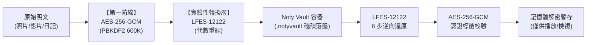

# Noty — 安全架構與威脅模型分析 (SECURITY_ARCHITECTURE.md)

> **版本**：Phase 9.75 Security Architecture Specification  
> **核心架構**：雙層防禦（AES-256-GCM 主力密碼防禦 + LFES-12122 實驗性轉換層）  
> **基礎設施**：Apple CryptoKit, CommonCrypto, macOS Keychain, LocalAuthentication

---

## 1. 威脅模型 (Threat Model)

Noty 作為「絕對私密、100% 離線」的私人回憶管理系統，其威脅模型涵蓋以下情境：

1. **實體設備未授權存取**：
   - 他人在使用者短暫離開 Mac 時操作介面。
   - **防禦**：LocalAuthentication (Touch ID) 與 Keychain 獨立備援密碼，自動閒置超時鎖定。
2. **磁碟直接讀取 (Direct Disk Inspection)**：
   - 攻擊者透過 Finder、終端機或磁碟掛載讀取 Application Support 目錄。
   - **防禦**：`AES-256-GCM` 4 MiB 分塊加密，原始檔案轉存為 `.notyvault` 認證容器；SwiftData 敏感欄位認證加密；未解鎖前磁碟僅有隨機密文與認證標籤。
3. **資料竄改與偽造 (Tampering & Forgery)**：
   - 攻擊者修改密文內容、置換分塊或截斷檔案。
   - **防禦**：GCM 16 位元組 Authentication Tag 與 AAD（關聯資料）綁定 Chunk 序號與檔案大小，任何竄改皆拋出 `authenticationFailed`。
4. **金鑰外洩與弱密碼字典攻擊**：
   - 攻擊者窮舉使用者密碼。
   - **防禦**：PBKDF2-HMAC-SHA256 實施 600,000 次密碼學迭代，並注入 32 位元組密碼學安全隨機 Salt。金鑰材料妥善保存於 Keychain，記憶體金鑰於鎖定時主動抹除。
5. **AI 推論洩漏 (Memory Leakage via AI)**：
   - 在保險庫鎖定時，第三方透過 AI 提問獲取記憶。
   - **防禦**：硬性隱私屏障（Privacy Barrier），保險庫鎖定期間，AI 檢索層全面拒絕存取任何日記正文與照片資訊。

---

## 2. 雙層加密管線架構

### 金鑰層級劃分 (Key Hierarchy)
1. **User Master Password**：由使用者設定，絕不存檔。
2. **Vault Salt**：32 位元組隨機生成，存於 Keychain。
3. **Master Key (256-bit)**：經 600,000 次 PBKDF2 推導，存駐於安全記憶體。
4. **Per-Chunk Nonce (96-bit)**：4 位元組 Salt 前綴 + 8 位元組大端序 Chunk 序號，保證全局唯一，零重用。
