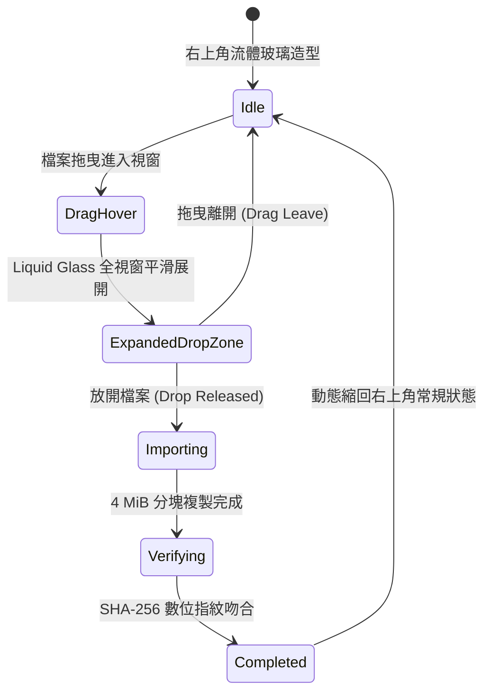

# Noty — 動態上傳與簽名級交互實施報告 (UPLOAD_SYSTEM_REPORT.md)

> **核心組件**：`DynamicUploadArcView.swift` & `DynamicFullWindowDropZone.swift`  
> **交互架構**：右上角流體圓弧玻璃 (Fluid Upload Wedge) + 全視窗拖放展開 (Drop Zone Morphing) + 動態進度圓弧 (Radial Arc Indicator)

---

## 1. 狀態機與交互週期

---

## 2. 核心技術落實

1. **Idle 狀態流體造型**：
   - 右上角以 `FluidUploadWedgeShape` 繪製有機圓弧玻璃幾何，向左上方優雅延伸。
   - 品牌優先級保證：透過合理分層與 zIndex，Noty Logo 與側邊欄按鈕保持清晰可見且 100% 可互動。
2. **全視窗拖放展開 (Global Drag Detection)**：
   - 支援由 Finder、桌面、下載資料夾拖曳單張或多張照片/影片至視窗任意處。
   - 觸發平滑 Morphing 動畫，展開為全視窗 Liquid Glass Drop Zone，顯示中央提示卡片與支援格式。
3. **Uploading 動態圓弧儀表**：
   - 放開檔案後，右上角切換為 `DynamicUploadArcView`。
   - 包含流光旋轉環、即時多檔案佇列計數（如 `12 / 30 Files`）、進度百分比與檔名。
4. **絕對非破壞性安全匯入**：
   - 複製至 `Temp/` -> 雙向校驗檔案大小與 SHA-256 -> 移入 `Media/` -> 建立 SwiftData 紀錄 -> 產生縮圖。
   - 絕對不移動或刪除原始來源檔案。
